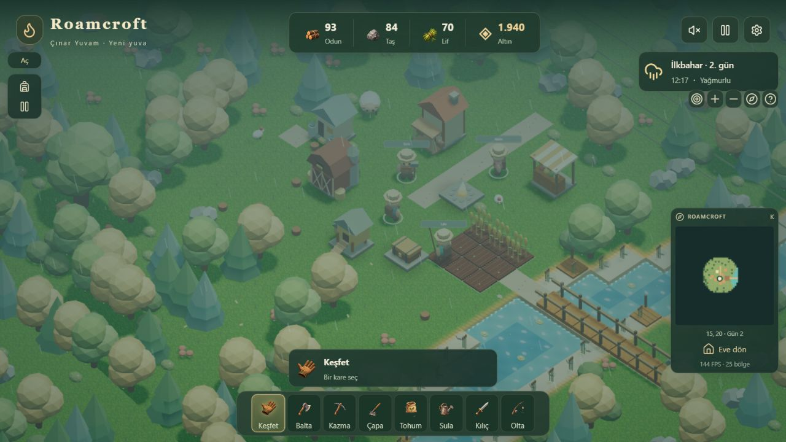
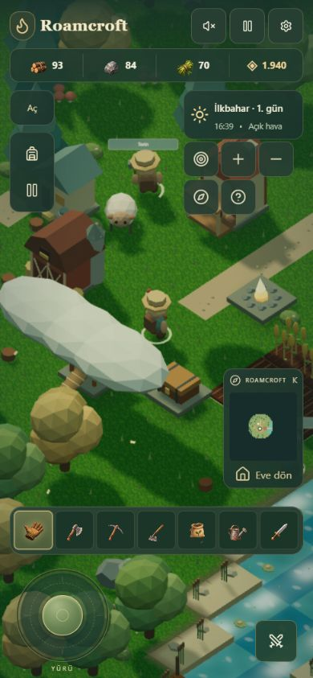

# Roamcroft

**Canlı oyun:** https://roamcroft.roamcroft.workers.dev

**Kaynak sürümü: 1.6.0 — Tarladan Atölyeye.** Ekim planı, tekrar hasat, seçilebilir makine tarifleri ve parti üretimi. [Değişiklikler](CHANGELOG.md) · [Sistem incelemesi](docs/system-gap-review.md) · [Doğrulama](docs/verification-1.6.0.md). Aşağıdaki ekranlar önceki 1.3.0 test çiftliğidir.





Türkçe, tek oyunculu, izometrik bir çiftçilik ve hayatta kalma oyunu. Oyun dünyası Three.js ile çizilir. **Oyna**, mevcut çevrimdışı çiftliği açar. **Sunucu dünyası · Önizleme**, ayrı bir çiftlikte oyun kurallarını Workers üzerinde yürütür; tarayıcı yalnızca hareket tahmini ve görüntü üretir. Bu önizleme hesap veya co-op sistemi değildir. Oturum çerezine bağlı erişim ve kapasite sınırları [güvenlik mimarisinde](docs/server-security.md) açıklanır.

## Çalıştırma

Node.js 22.13.0 veya üzeri ve npm gerekir. CI ve Cloudflare için .node-version kullanılır.

```powershell
npm ci
npm run dev
```

Terminalde görünen yerel adresi aç. Üretim derlemesi ve kontroller:

```powershell
npm run typecheck
npm test
npm run build
npm run start
```

## Kontroller

| Girdi | Eylem |
| --- | --- |
| WASD / yön tuşları | Yürü |
| Sol tık | Hedefe yürü, seçili aracı kullan |
| 1–8 | Keşfet, balta, kazma, çapa, tohum, sula, kılıç, olta |
| Tab | Tek pencere menüsünü aç/kapat |
| E | Yakındaki kişi, hayvan, ürün veya yapı ile etkileşim |
| Menüde Q/E | Önceki/sonraki sekme |
| Shift | Enerji harcayarak koş |
| Ctrl | Yakındaki düşmana saldır |
| İnşada ←/→ | 90° döndür |
| Sürükle | Kamerayı taşı |
| Tekerlek / iki parmak | Yakınlaştır/uzaklaştır |
| Esc | Menüden veya inşadan çık; duraklat |

360° dijital joystick sol altta, saldırı sağ altta sabittir. Dokunma alanları en az 44 px'tir; dar ekranlarda sol menü kapalı başlar. Ana menüde tam ekran ve destekleyen tarayıcılarda Ana Ekrana Ekle bulunur. iOS'ta Safari Paylaş → Ana Ekrana Ekle kullanılabilir.

Ses ilk kullanıcı etkileşiminden sonra Ses düğmesiyle açılır. Ayarlar'da müzik, doğa ve aksiyon sesleri ayrı ayarlanır. Ayrıntılı görüntü varsayılandır; çözünürlük ve gölgeler cihazın kare süresine göre dengelenir.

## Oyun kuralları

- Köy adını Kamp menüsünden değiştir. Günlükte kısa görev, sıradaki köy dönüm noktası ve uzun vadeli miras hedefi birlikte görünür. Beş dönüm noktası sırayla ve yalnızca bir kez malzeme verir: ilk hasat ve satış → atölye malzemeleri → sulama ve yem → işlenmiş ürünler → madencilik ekipmanı ve keşif erzakları. Ödüller köy adınla kayda işlenir.
- Emanet menüsündeki dört koleksiyon sandığına kısmi bağış yapılabilir. Hasat sandığı çantayı 600'den 900 eşyaya çıkarır; çiftlik sandığı hayvanların günlük üretim hazırlığını %20 hızlandırır; ustaların sofrası makineleri %15 hızlandırır; sulama sandığı fıskiye menzilini 1'den 2 kareye çıkarır. Tab → Emanet ile açılır.
- Bakır fıskiye, malzeme tarifinden üretilip dünyaya yerleştirilir. Bitişik sekiz ekim karesini sürekli sular; sulama emanetiyle 24 kareye ulaşır. Sulama/sera kapsamı küçük yapı alanları üzerinden hesaplanır.
- Hayvanlar oyun günü başına bir yem tüketir ve en fazla bir üretim partisi hazırlar. Hazır ürün hayvana tıklanarak veya Çiftlik menüsünden toplanır. Yakınlığı 60 olan hayvanın partisi iki üründür. Toplanmayan ürün hayvanda 12 adede kadar bekler. Çanta doluysa toplama reddedilir; ürün silinmez.
- Çanta dolduğunda kırmızı uyarı çıkar. Satın alma durur; makine çıktısı sığmıyorsa girdiler harcanmaz. Hasat, tarif ve görev gibi kazanılan fazla eşyalar kayıtlı teslimat sandığına aktarılır; Çanta menüsünden yer açıldığında alınır. Eski kayıtlardaki kapasite üstü eşyalar korunur.
- Günlük sohbet köylü başına bir kez +2 dostluk verir. Gün değiştikçe diyalog değişir. Madenin ulaşılan katları asansöre kaydedilir; sonraki gün açılmış kattan keşfe başlanabilir.
- Enerji 20'nin altına indikçe hem tıklayarak hem tuşlarla yürüme kademeli yavaşlar; sıfır enerjide de yürünebilir. Görev ve köy ödülleri kısa konfeti efekti verir; azaltılmış hareket tercihinde efekt gösterilmez.
- Sol paneller daraltılabilir, etkin araç altın çerçeveyle vurgulanır. Nehir kıyısı geçişleri yumuşatılır ve her iki görüntü kalitesinde bina taban gölgeleri çizilir. Kamera nehir ve ağaçlara yaklaştıkça çevre sesi güçlenir; dönüşe göre stereo yön değişir. Gece, yağmur ve madende kuşlar susar. Menüde çevre sesleri yumuşakça kısılır.

- Hareket yönünde üretilen, sabit kenarı olmayan dünya. 12 × 12 karelik bölgelerden yalnızca oyuncunun çevresindeki 25 bölge (3600 kare) etkin tutulur. Beş dış biyom ve başlangıç köyü. Değiştirilmemiş arazi deterministik olarak yeniden üretilir; oyuncunun değişiklikleri kaydedilir. Uzak tarla, üretim yapısı ve hayvanlar yüklü alan dışındayken bekler.
- Bir gün 5 dakika, bir mevsim 7 gün. Oyun, menüler açıkken veya sekme görünmüyorken durur. Kapatıldığında ilerleme hesaplanmaz.
- Altı ekin; çapalama, ekme, sulama, gübre, hasat, tohum geri kazanımı ve mevsim koşulları. Uygun mevsimde olmayan ekinler ölmez; büyümeleri durur.
- Yirmi yapı türü. Başlangıç evi ve pazar korunur. Yapılar 3. seviyeye kadar yükselir; gözcü kulesi, sur, kuyu, sera ve üretim yapıları kendi davranışlarına sahiptir. Yükseltilen yapılar taş destekler, ek depolama, küçük silolar veya köy sancakları kazanır.
- El üretiminde üç işlik kuyruk; üretim, malzeme ve enerji harcar. Yapıların otomatik üretimi malzemeleri ortak çantadan alır; yapı yönetiminden durdurulabilir.
- Ayrı Çiftlik menüsünde tavuk, inek ve koyun; ad verme, günlük ilgi, yakınlık, iki yetişkinden yavru, iki günde büyüme, üç günlük yavrulama aralığı. 60 yakınlıkta çift ürün. Hayvanlar engelleri dolaşarak sekiz kare yarıçaplı meraya yürür, gece yuvalarına döner ve ilgilenildikten sonra kısa süre oyuncuyu takip eder. Hayvan rota aramaları kare başına iki hayvanla sınırlandırılır. Kümes 1., ahır 3. seviyede açılır.
- Yem değirmeni, balık tütsühanesi ve dokuma atölyesi; buğday → yem, balık → yemek, yün → sargı üretim zincirleri.
- Sağlık, enerji, doygunluk, dinlenme, yemek, evde uyuma, balıkçılık ve ekipman yükseltmeleri.
- Üçüncü günden başlayarak her üçüncü gece akın. Yakın dövüşte engeller görüşü keser. Düşmanlar yol bulur, savunma yapılarına hasar verir. Yenilgi karakteri eve döndürür ve altının %10'unu alır.
- 30 karakter seviyesi; beş ustalık; altı ayrı, beş kademeli yetenek. Yetenek seçimi sınırlı seviye puanlarıyla yapılır.
- Üç köylü, günlük sipariş ve hediye sınırları, 100 puanlık dostluk. Dostluk gerçek fiyat, üretim ve balıkçılık avantajları verir.
- 18 görev, 12 başarım ve üç ödüllü keşif noktası. Kadim feneri 3. seviyeye yükseltmek akınları bitirir; serbest köy yaşamı devam eder.
- Madenin üçüncü seviyesinde açılan beş katlı Kadim Maden. Her oyun günü bir keşif; her katta düşmanları temizleyip dört cevher birimi kazdıktan sonra kuzey geçidinden ilerleme. Güney asansörü ganimetle dönüş sağlar. Beşinci katın Derinlik Muhafızı yarı canında hızlanır; son geçit keşif ödülünü verir.
- Bozkurt, mağara peltesi, kül büyücüsü, taş muhafız ve bölüm sonu muhafızı. Saldırı öncesi yere çizilen halkalar hedef alanı gösterir; hareket ederek kaçılabilir. Düşman can çubukları gerçek sağlık değerini gösterir.
- Madendeyken vadi saati, tarlalar ve hayvanlar bekler. Açlık, savaş ve eldeki üretim kuyruğu çalışır. Maden katı, kalan düşmanlar, hazırlanmakta olan saldırılar ve yüzeydeki köy birlikte kaydedilir. Yenilgi köyü geri yükler.

## Kayıt ve taşınabilirlik

Roamcroft, önceki Ocak Vadisi kayıtlarını aynı site adresinde okumaya devam eder. Tarayıcı veritabanı, yedek anahtarları ve kayıt zarfının iç kimliği uyumluluk için korunur; oyun adı ve indirilen kayıt dosyasının adı Roamcroft'tur.

Kayıt, yaklaşık her 15 oyun saniyesinde uygun bir boşlukta bu tarayıcının IndexedDB veritabanına asenkron yazılır. Önceki localStorage kayıtları okunur; sayfa kapanışında küçük yerel kontrol kaydı denenir. IndexedDB kullanılamazsa localStorage yedeğine geçilir. Son geçerli kayıt ayrıca yedeklenir. JSON dışa aktarma ve içe aktarma Kamp menüsündedir. İçe aktarma; sürüm, bütünlük özeti, sayısal sınırlar, envanter, yapı konumları, kimlikler ve ilerleme alanlarını kontrol eder. Başka cihazda aynı vadide devam etmek için kayıt dosyasını taşı.

Bu sürümün kaydı cihaz ve site adresine bağlıdır; yerel adresle yayımlanmış adres aynı kayıt alanını paylaşmaz. Yerel önizlemede oynadıysan Kamp menüsünden dosyayı indirip yayımlanan oyuna yükle.

## Kod yapısı

- `lib/game/settlement.ts`: adlandırılabilir köy, beş sıralı dönüm noktası, kaynak ve üretimle birbirini besleyen ödüller.
- `lib/game/progression.ts`: dört koleksiyon sandığı, kapasite, enerjiye göre hız ve alan tabanlı sulama/sera hesapları.
- `lib/game/ambience.ts`: kamera uzaklığı, dönüşü, yakınlaştırması ve hava durumundan çevre sesi karışımı.

- `lib/game/model.ts`: simülasyon, yol bulma, ekonomi, üretim, savaş, sosyal ilişkiler ve ilerleme.
- `lib/game/data.ts`: eşya, ekin, yapı, tarif, görev, hayvan ve yetenek tanımları.
- `lib/game/content.ts`: köylü diyalogları, günlük siparişler, keşifler ve başarımlar.
- `lib/game/expedition.ts`: maden haritası üretimi, katlar, geçitler ve düşman davranış tanımları.
- `lib/game/scene.ts`: prosedürel 3B modeller, arazi, kamera, seçme, gölgeler, animasyon ve hava efektleri.
- `lib/game/save.ts` ve `storage.ts`: kayıt doğrulama, eski kayıt geçişi, IndexedDB ve yedekleme.
- `lib/game/batches.ts`: farklı renkli nesnelerin dünya genelinde ortak çizimi, boşalan örnek yuvalarının yeniden kullanımı ve yapı modellerinin birleştirilmesi.
- `lib/game/world.ts`: bölge üretimi, hareketli etkin pencere ve değişikliklerin korunması.
- `components/game/GameIcon.tsx`: emoji kullanmayan, ortak oyun simgeleri.
- `lib/game/audio.ts`: özgün üretken müzik ve ses efektleri.
- `lib/game/webmcp.ts`: destekleyen tarayıcılarda aynı oyun motoruna erişen isteğe bağlı araçlar.
- `components/game`: HUD ve etkileşimli oyun panelleri.
- `tests`: oyun kuralları, ilerleme, kayıt ve 3B seçim regresyon testleri.
- `public/art`: bu oyun için üretilmiş, dört sayfada 64 özgün eşya ve yapı çizimi.
- `public/textures`: bu proje için üretilen özgün çayır, toprak ve ahşap kaplamaları.

## Doğrulama sınırı

99 otomatik test; simülasyon, kayıt geçişi, ekonomi, sosyal ilişkiler, A*, dokunma hareketleri, çevrimdışı kabuk, bulut koordinatları, CSP ve kapalı co-op uç noktasını kapsar. `npm run start` sonrasında `npm run check:http` gerçek üretim yanıtlarındaki altı başlığı ve HTML nonce eşleşmesini denetler. Test ayrıntıları [1.3.1 doğrulama notlarında](docs/verification-1.3.1.md) tutulur.

Bulut kayıt ve co-op bu sürümde kapalıdır. [Çevrimiçi yol haritası](docs/online-roadmap.md) gelecek aşamaları açıklar.

## Görüntü ve performans

SSAO ve ara görüntü tamponu zinciri kaldırıldı. İki kalite modu da doğrudan aynı WebGL sahnesini çizer. Ayrıntılı mod güneş gölgeleri ve yüksek çözünürlük açar; yavaş cihazlarda çözünürlük otomatik azalır. WebGL bağlamı geri geldiğinde dengeli moda dönülür. Tek ekin değişimi yalnızca bulunduğu bölgeyi günceller. Ağaç, kaya ve ekin parçaları ortak geometri kullanan InstancedMesh gruplarıdır. Bölge hazırlığı karelere dağıtılır; uzak grupların GPU kaynakları bırakılır.

Otomatik kontrol: 300 bölge geçişinde etkin arazi 3600 karede kaldı; değiştirilmemiş keşif kayıt büyütmedi. Ortak statik dünya testinde 25 bölge 5 çizim grubunda toplandı (bu sayı tüm sahnenin çizim sayısı değildir; gerçek dokular ek malzeme grupları oluşturabilir). Yerel Node testinde bölge verisi geçişlerinin medyanı yaklaşık 2–3 ms, p95 4–6 ms. Bu işlemci ölçümleri gerçek tarayıcı FPS veya bütün cihazlarda sıfır takılma garantisi değildir. FPS göstergesi oynanan cihazdaki kare aralığını gösterir.

Yeni dünyalar kıvrımlı nehirler ve geçilebilir kıyı yolları içerir. Önceki kayıtların arazi üretim sürümü korunur; mevcut köy sıfırlanmaz. Eski nehirlerde de yeni su, sazlık, nilüfer ve balıkçı platformu görselleri kullanılır. Yeni aktif alan, eski 36×36 alanın 2,78 katıdır. Maden katları 36×36 olarak kalır.

Eşya simgeleri emoji veya işletim sistemi ikonlarından bağımsız özgün resimlerdir. Ev verandası, çift kapılı ve silolu ahır, ayaklı/rampalı kümes, açık tezgâhlı marangoz, taş fırın, mandıra ve sera farklı model siluetlerine sahiptir. Modeller renk bilgilerini koruyarak birleştirilir. Ana arayüzde arka plan bulanıklığı kullanılmaz. Ayrıntılı görüntü kapalıyken de su animasyonu ve canlı hareketler çalışır.


## Cloudflare yayını

Tek yapılandırma kaynağı deployment.config.json'dur. Derleme sonundaki finalize-build betiği üretilen dist/server/wrangler.json içindeki D1 kimliğini doğrular. Dosyayı elle düzeltmek gerekmez.

Yerel yayın komutları:

    npx wrangler login
    npm run typecheck
    npm test
    npm run build
    npm run deploy

Otomatik yayın için Cloudflare → Workers & Pages → roamcroft → Settings → Builds → Connect Git bölümünden user02718281828/Roamcroft deposu ve main dalı bağlanmalıdır. Proje kökü /, build komutu npm run build, deploy komutu npx wrangler deploy --config dist/server/wrangler.json, NODE_VERSION=22.13.0 olmalıdır. Üretim dışı dal yayını kapalı tutulur. Hesap bağlantısı tamamlanmadan yalnızca repodaki GitHub doğrulama iş akışı çalışır; otomatik yayın kurulmuş sayılmaz.

[Cloudflare yapılandırma belgesi](https://developers.cloudflare.com/workers/ci-cd/builds/configuration/) ve [build ortamı](https://developers.cloudflare.com/workers/ci-cd/builds/build-image/).

Hatalı bir yayında önceki sürüme dönmek için npx wrangler rollback kullanılabilir. Tarayıcıdaki dünya kaydı bundan bağımsızdır; değişikliklerden önce JSON yedeği alınabilir.

## Açılış bütçesi ve çevrimdışı kullanım

Yedi PNG görseli toplam 14.02 MB'den 0.92 MB WebP'ye dönüştürüldü. Ham kaynaklar Git geçmişinde korunur. Menü yalnızca açıldığında yüklenir; Three.js çekirdeği ve çizicisi ayrı paketlerdir. Sistem yazı tipleri kullanılır, indirilecek web fontu yoktur.

Her derleme statik dosya toplamını 3 MB ile sınırlar ve dist/client/asset-budget.json raporunu üretir. Rapor sıkıştırılmış aktarımı tahmin eder; gerçek ağ ölçümü değildir. Dünya yükleme çubuğu tamamlanan dokuları ve arazi bölgelerini sayar.

Service worker, ilk başarılı çevrimiçi açılışta uygulama kabuğunu, kodu ve WebP dokularını saklar. Kurulum tamamlandıktan sonra oyun çevrimdışı açılabilir. API istekleri önbelleğe alınmaz. Güncelleme yeni oturumda etkinleşir; devam eden oyun zorla yenilenmez.

Genişletilmiş içerik kapsamı ve tamamlanma durumu: [Gelişim planı](docs/development-plan.md).

<!-- Otomatik deploy testi -->
