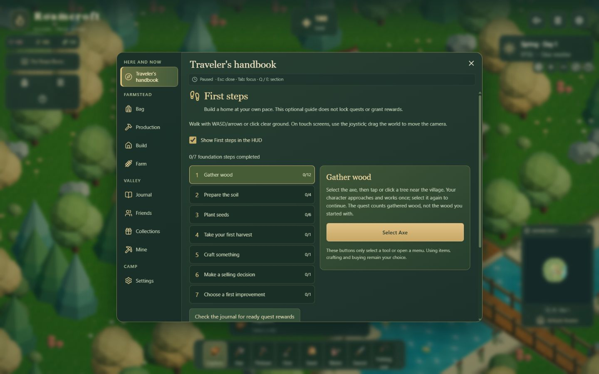
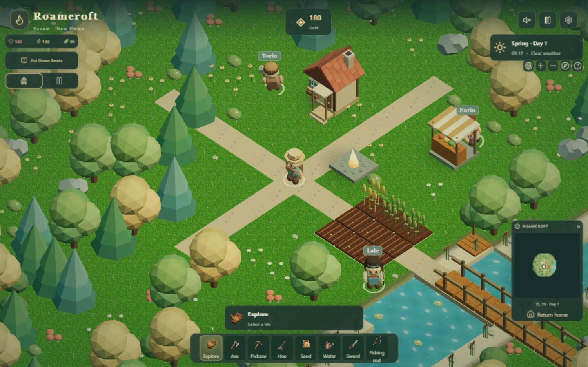
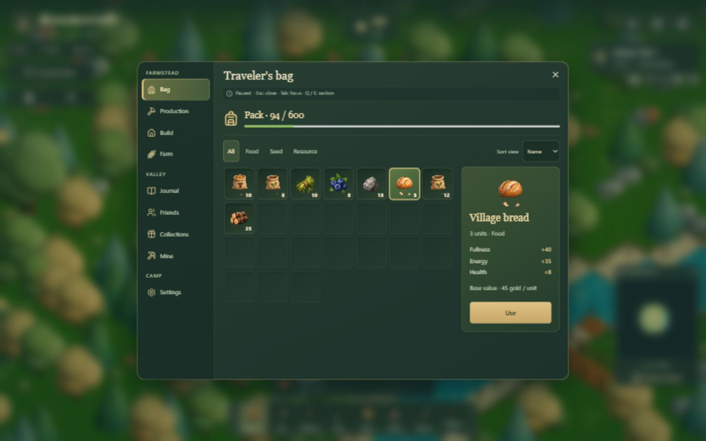

# Roamcroft

An original isometric browser game about building a home in a living valley:
grow crops, craft supplies, explore the wilderness and share a farm with friends.
The world, characters, models, item artwork and generative music have their own
identity. Stardew Valley and Minecraft are experience references, not asset or
design sources to copy.

[Türkçe](README.tr.md) · [Changelog](CHANGELOG.md) · [2.0 master plan](docs/ROAMCROFT_2_0_MASTER_PLAN.md)

**Development source: 1.13.0 — Gameplay Foundation, pending release approval.**
The live version was verified as **1.12.0** on 29 October 2026. This is a limited
foundation package, not a completed Roamcroft 2.0 release.
[Live game](https://roamcroft.roamcroft.workers.dev) is deployed separately;
the source branch and its screenshots do not prove that the live build has updated.



The 1.12.0 UI foundation is shown below; these images are not labeled as 1.13.0 captures.





These are real local browser captures of the labeled versions. Older files in
`docs/screenshots` are historical references, not current release screenshots.

## Play

- **English and Turkish.** First visits start in English. An explicitly saved
  language choice is preserved; change it on the start screen or in Settings.
- **Device farm:** offline play after the PWA shell is cached. Time does not
  advance while the game is closed. Saves belong to this device and site origin.
- **Server farm / shared surface farm, beta:** up to four players, independent
  bags and characters, shared gold, world, storage, production and progress.
  The Cloudflare Durable Object is authoritative; the host must remain connected.
  Shared sleep is implemented. Shared mining and independent distant exploration
  are not implemented; shared exploration stays near the host, about 20 tiles.
- Download a save file to keep an offline copy. Server identity uses a secure
  browser cookie, renewed for 30 days on connection. Clearing it loses access;
  accounts and recovery are not implemented. Client save uploads to the server
  are not accepted.

## What's implemented

- Six seasonal crops, irrigation, fertilizer, greenhouses and permanent apple/pear orchards.
- 24 building definitions, three upgrade levels, production batches and optional automatic repeat.
- Chickens, cows and sheep; feeding, affection, manual collection and breeding.
- Crafting, market, deterministic daily orders, shared storage and protected overflow rewards.
- Three villagers with schedules, gifts, friendships and dialogue; six earned story chapters.
- 30 character levels, five skills, six talent branches, 20 quests, 12 achievements,
  four collections and five village milestones.
- Surface raids, five enemy types and a five-floor mine with lift checkpoints and a boss.
- A deterministic streaming world: 25 active chunks / 3,600 tiles, with saved edits.
- Warm grouped camp navigation, icon slots and selected-item details in the pack,
  a compact HUD and mobile section picker.
- Optional First steps: seven earned-progress checkpoints, tool selection and
  menu shortcuts; no new rewards or unlock gates. Hide its HUD button and reopen
  the guide in Settings. Tool notes explain current energy and upgrade benefits.

Starting stock, prices, quest rewards and old saves are unchanged in 1.13.0.
`npm run audit:first-session` compares the current start with an experiment-only
sparse profile. The scripted route is not a human playtest or a retention result.
See the [first-session analysis](docs/gameplay-foundation-1.13.0.md).

The pack remains the existing quantity-based inventory (600 units, or 900 with
the collection reward). Its visual slots add no storage limit or capacity.
Sorting changes the view only. The tool bar still has eight fixed tools; an
item-based customizable hotbar, equipment and drag-and-drop are planned.

## Controls

| Input | Action |
| --- | --- |
| WASD / arrow keys | Walk |
| Click terrain | Walk / use selected tool |
| 1–8 | Select tool |
| Tab / Escape | Open camp menu / close menu; Tab moves focus inside it |
| Q / E in menus | Previous / next section |
| E in the world | Interact nearby |
| Shift | Run, spending energy |
| Ctrl | Attack |
| Mouse wheel / pinch | Zoom |
| Drag | Pan camera |
| Esc | Close menu / exit building / pause |

Touch controls include a joystick and dedicated interact/attack buttons.
Opening a menu pauses the offline farm; it does not pause other online players.
Sound requires a user gesture. Balanced graphics is the default; detailed
graphics is optional and is not silently reduced during play.

## Develop and verify

Node **22.13.0** is the CI baseline; use npm and the committed lock file.

```sh
npm ci
npm run dev
```

```sh
npm run typecheck
npm test
npm run build
npm run check:runtime
```

Build creates local output only. `check:runtime` uses local Worker/D1/DO test
data and four WebSocket clients. Never point fixture tests at production.
To preview the built Worker locally, run `npm start`. Stop it before rebuilding
on Windows so it does not lock `dist/client`.

Static JS/CSS/images have a **3,000,000-byte budget** checked during build.
`dist/client/asset-budget.json` reports raw size and estimated compressed size;
neither is a real network or physical-device benchmark. Profiling is opt-in
at `?profile=1`. Desktop viewport emulation is not a physical Android test.

## Architecture and saves

TypeScript / React 19 / Three.js, Vinext/Vite and Cloudflare Workers with D1 and
room-local SQLite Durable Objects. `app/page.tsx` loads the launcher, then the
game, renderer and menus lazily. The game engine owns rules; rendering and
localization do not own inventory or simulation state.

`lib/game/model.ts` owns the simulation, `lib/game/data.ts` its catalog,
`lib/game/scene.ts` the renderer, `lib/server` the authoritative economy and
`lib/coop` realtime movement. `lib/i18n` contains typed TR/EN catalogs.

Save version 1 and the legacy `ocak-vadisi` identifiers are intentionally
preserved. IndexedDB rotates two snapshots atomically with localStorage fallback;
imports validate format, integrity and game bounds. The checksum is corruption
detection, not a cryptographic anti-cheat signature. Restoring this repository
does not restore a lost browser cookie or player save.

## Status, security and publishing

[1.13.0 verification](docs/verification-gameplay-1.13.0.md) · [UI baseline](docs/verification-ui-1.12.0.md) · [i18n baseline](docs/verification-portal-i18n.md)
· [Portal roadmap](docs/PORTAL_ROADMAP.md) · [Contributor rules](AGENTS.md)

The historical audit had **23 open package findings**. The 29 October install
and audit report **25** (3 critical, 10 high, 11 moderate, 1 low), tracked in
the master plan and portal roadmap. Toolchain
exposure and live Worker exposure require different analysis. This UI package
preserves the existing Sentry dependency and does not upgrade dependencies or
claim to resolve those findings. Browser error monitoring keeps only error type,
release and code locations; free-form messages, player data, requests, breadcrumbs
and attachments are removed before sending. Replay and tracing are disabled.

Cloudflare Workers Builds has run for `main`. Pushing a development branch is
not production deployment approval. CI verifies `main`, `feature/**`, `codex/**`
and pull requests; production pushes/deploys need the user's explicit scope.
GitHub Pages has not been verified as a hosting source (the Pages API returned 404).

Portal SDKs, ads, analytics, prestige, accounts/recovery, shared mines and
independent distant co-op exploration remain planned. Physical mobile, real WAN,
long-session and portal iframe testing remain release gates. The existing social
sharing JPG still has Turkish lettering; localized marketing artwork is pending.
