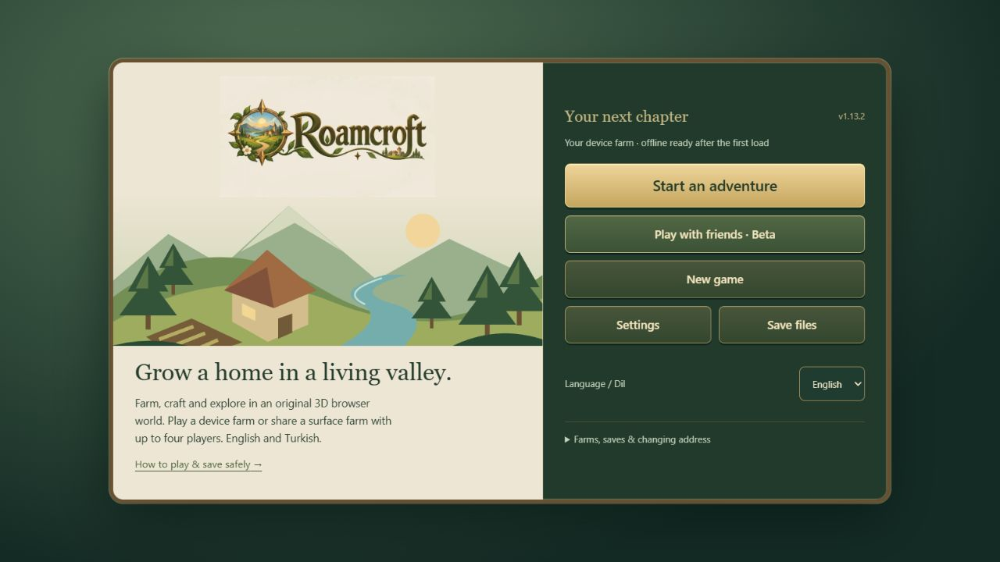

# Roamcroft

Resmî adres: [roamcroft.com](https://roamcroft.com). Domain/SEO/marka paketi
bu sürüme dahildir; [oynanış ve kayıt rehberi](https://roamcroft.com/how-to-play)
bulunur. Tek herkese açık oyun adresi roamcroft.com'dur; eski workers.dev
Production ve Preview adresleri kapalı kalmalıdır. Bu yerel koruma yayımlanmadı;
30 Ekim salt okunur kontrolde eski Production hâlâ HTTP200 verdiğinden
Dashboard kapanışı ayrıca doğrulanmalıdır. Eski IndexedDB/localStorage kayıtları
origin'e bağlıdır ve otomatik taşınmaz. Tarayıcı profilini/site verilerini koru;
var olan JSON yedeğini veya [güvenli kurtarma prosedürünü](docs/DOMAIN_POLICY.md)
kullan. JSON sunucu sahipliğini taşımaz; adresin kapanması oyuncu verisini silmez.

Tek logolu karşılama ve çanta/depo ayrımı canlı sürüme dahildir.
Aşağıdaki tarihsel Camp Art görüntüsü yerel tarayıcıdan alındı; yeni alpha.3
HUD'ını veya fiziksel telefon kabulünü göstermez.



Yaşayan bir vadide kendi yuvanı kurduğun özgün izometrik tarayıcı oyunu:
ekin yetiştir, kaynak topla, üret, keşfet ve arkadaşlarınla çiftlik kur.

[English](README.md) · [Değişiklikler](CHANGELOG.md) · [2.0 master planı](docs/ROAMCROFT_2_0_MASTER_PLAN.md)

**1.14.0-alpha.3 — Quality Recovery**.
Kaynak/kabul sınırları: [alpha.3 yayın kaydı](docs/verification-release-1.14.0-alpha.3.md).
Önceki doğrulanmış canlı checkpoint alpha.2/main `914bde9`;
CI/Workers Builds/iki origin kanıtı [ayrı kayıttadır](docs/verification-release-1.14.0-alpha.2.md).
Gerçek Three.js sahnesinde üç ağaç silueti, altı yer örtüsü, tavşan ve kuş var.
[Orman kanıtı](docs/verification-living-forest.md). Kullanıcı alpha.1 Android
menü/girdi/hotbar/depo kabulünü geçti; ormanın fiziksel performansı hâlâ bekliyor.
Tam ekipman/stack/sürükle-bırak henüz yoktur.

Kalite kurtarma kaynağı: `codex/quality-recovery` / `413d0a4`.
Önceki HUD/rehber dalının geçmişi korunarak devam edildi. Ortak orman modelleri,
bölge bazlı eleme ve yalnız görünür ot örnekleri çizim yükünü azaltır. Sade HUD,
dar ekranda dokuz yuvalı palet, yatay kompakt çanta ve karakteri açık bırakan
inşa/ekim kontrolleri dahildir. Kontrollü alpha.3 üretim yayını kullanıcıca
onaylandı; fiziksel Android kabulü hâlâ bekliyor.
[Kalite kurtarma ve ölçümler](docs/verification-quality-recovery-alpha.3.md) ·
[HUD kanıtı](docs/verification-mobile-hud-alpha.3.md) ·
[Rehber kanıtı](docs/verification-guide-scroll-alpha.3.md).

1.13.1: safe-area uyumlu joystick, kalıcı sağ/sol/boyut/hassasiyet tercihi,
ayrı kullanım/saldırı alanları, iptal edilen girdi temizliği, oyun içi bölüm
menüsü, oranı korunan atlas ikonları, açılır çanta ayrıntıları ve onaylı depo
aktarımı. [Doğrulama ve cihaz kontrol listesi](docs/verification-mobile-1.13.1.md).
30 Ekim kontrollü yama sonrası kaydedilen audit **20:0 kritik/8 yüksek/
11 orta/1 düşük**; yama alpha.1'de yayımlandı, alpha.2'de korunur.
[Risk incelemesi](docs/security-audit-2026-10-30.md). Bu HUD/rehber işinde
bağımlılık yükseltilmedi; açık paket sayısı canlı istismar sayısı değildir.

## Güncel sistemler

- Türkçe/İngilizce; ilk açılış İngilizce, açıkça saklanmış dil tercihi korunur.
- Altı ekin, mevsim, sulama/sera/gübre ve kalıcı elma/armut bahçeleri.
- 24 yapı, üç seviyeye kadar yükseltme; el üretimi, parti üretimi ve isteğe bağlı otomatik tekrar.
- Tavuk, inek, koyun; günlük yem, elle toplama, yakınlık ve yavrulama.
- Pazar, günlük sipariş, ortak depo ve taşan kazanımlar için teslimat sandığı.
- Üç NPC, rutin/dostluk/hediye ve altı ilerleme hikâyesi bölümü.
- 30 seviye, beş ustalık, altı yetenek dalı, 20 görev, 12 başarım,
  dört koleksiyon ve beş köy dönüm noktası.
- Gece akınları, beş düşman türü ve asansörlü beş katlı maden/boss.
- Tohumdan üretilen kayan dünya; 25 etkin bölge / 3.600 kare ve saklanan arazi değişiklikleri.
- İsteğe bağlı İlk Adımlar: yedi hedefin mevcut sayaçlarla takibi, araç seçimi
  ve menü kısayolları. HUD düğmesi kapanabilir; rehber Ayarlar'dan yeniden açılır.
  Yeni ödül/kilit yoktur. Araç notları enerji ve yükseltme faydalarını açıklar.

1.13.0'da başlangıç stokları, fiyatlar, görev ödülleri ve eski kayıtlar değişmez.
`npm run audit:first-session` gerçek başlangıçla yalnız deney amaçlı sade profili
karşılaştırır; insan oyuncu süresi/tutundurma ölçmez.
[İlk oturum incelemesi](docs/gameplay-foundation-1.13.0.md) ve
[1.13.0 doğrulaması](docs/verification-gameplay-1.13.0.md) kapsamı açıklar.

Yeni çanta yuvaları yalnız görünümdür. Çanta hâlâ toplam miktar tutar; normal
kapasite 600, koleksiyon ödülüyle 900'dür. Eşya seçmek tüketmez; ayrı eylem
düğmesi kullanılır. Görsel sıralama kayıt stoklarını değiştirmez. Araç çubuğu
bu geliştirme dalında dokuz atanabilir araç/eşya referansı ve canlı stok gösterir.
Seçim tüketmez; açık kullanım mevcut oyun kurallarını izler. Ekipman ve
sürükle-bırak henüz yoktur; bu çalışma canlıya yayımlanmadı.

## Üç ayrı oyun/kayıt alanı

**Cihaz çiftliği:** PWA kabuğu önbelleğe alındıktan sonra çevrimdışı çalışır.
Oyun kapalıyken ilerleme hesaplanmaz. Kayıt cihaz ve origin'e bağlıdır.

**Kişisel sunucu çiftliği:** Kurallar Workers üzerinde yürür. Güvenli oturum
çerezi her bağlantıda 30 gün yenilenir. Çerez silinirse erişim kaybolur;
hesap/kurtarma henüz yoktur. Sunucuya JSON kayıt yüklenemez.

**Ortak yüzey çiftliği, beta:** Dört oyuncuya kadar; kişisel çanta/karakter,
ortak altın/dünya/depo/ilerleme. Otorite ev sahibinin bilgisayarı değil Durable
Object'tır. Ev sahibi bağlı olmalıdır; 15 saniye tolerans ve 5 dakika kapanma
akışı vardır. Ortak uyku uygulanmıştır. Yaklaşık 20 karelik yakın keşif sınırı
vardır; ortak maden ve uzak bağımsız keşif kapalıdır.

## Kontroller ve geliştirme

WASD/oklar yürüme; 1–9 bağlı araç/eşya; Tab menü; E kullanım/etkileşim; Shift koşu;
Ctrl saldırı; fare tekerleği/pinch yakınlaştırma; sürükleme kamera;
Esc menü/inşadan çıkış veya duraklama. Menüde Q/E bölüm, Tab odak değiştirir.
Dokunmada joystick ve ayrı saldırı/etkileşim düğmeleri vardır. Menü çevrimdışı
çiftliği durdurur, ortak dünyadaki arkadaşlarını durdurmaz.

Node 22.13.0 CI tabanıdır. Sıra:

```sh
npm ci
npm run typecheck
npm test
npm run build
npm run check:runtime
```

`npm run dev` geliştirme, `npm start` yerel üretim Worker önizlemesidir.
Windows'ta build öncesi önizlemeyi kapat. Build yayın yapmaz. Statik bütçe
3.000.000 bayttır; sıkıştırılmış boyut tahmini gerçek ağ ölçümü değildir.
Tanılama `?profile=1` ile açılır. Dengeli kalite varsayılandır.

## Uyumluluk ve açık işler

Kayıt sürümü 1 ve eski `ocak-vadisi` anahtarları bilerek korunur. IndexedDB
iki yedekli atomik rotasyon, localStorage geri dönüşü ve JSON içe/dışa aktarma
vardır. Depoyu geri yüklemek tarayıcı kaydını/çerezini geri getirmez.

Tarihsel audit 23 bulguydu. 1.13.0'ın 29 Ekim kurulum/audit sonucu 25'ti (3 kritik,
10 yüksek,11 orta,1 düşük). Kontrollü yama sonrası20 bulgu yukarıda ayrılmıştır;
kalanlar giderilmiş sayılmaz. Mevcut Sentry bağımlılığı korunur. Hata gönderiminde yalnız tür/sürüm/kod
konumu tutulur; oyuncu/kayıt/istek verisi ve serbest mesajlar filtrelenir.
Portal SDK/reklam/oynanış analitiği, prestij,
hesap/kurtarma ve diğer 2.0 hedefleri [master planda](docs/ROAMCROFT_2_0_MASTER_PLAN.md)
durum/kabul koşullarıyla izlenir. Fiziksel cihaz, gerçek WAN, uzun oturum ve
portal iframe testleri tamamlanmış sayılmaz. Sosyal paylaşım JPG'sindeki Türkçe
yazıların yerelleştirilmesi bekler.

Main üzerindeki Cloudflare Workers Builds bağlantısı doğrulandı. Bu görevde
yayın için önce geliştirme dalı, tüm kontroller ve güncel main birleşimi gerekir.
Geliştirme dalı push'u üretim yayını değildir; oturumun açık izni esas alınır. GitHub Pages
API sorgusu 404 döndü; Pages'in gerçek yayın kaynağı olduğu varsayılmaz.
`deployment.config.json` içindeki `workers_dev:false`/`preview_urls:false`
Vite ve build finalizer üzerinden gerçek hedef `dist/server/wrangler.json`'a
uygulanır. Custom domain/www yönlendirmesi Dashboard'da korunur.
[Dağıtım ve kurtarma ilkesi](docs/DOMAIN_POLICY.md).
[Doğrulama](docs/verification-ui-1.12.0.md) ve [AGENTS](AGENTS.md) ayrıntıları içerir.
